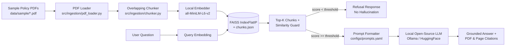

# DocuMind AI — System Architecture (V1 Baseline & V2 Roadmap)

## 1. Version 1 (Baseline) Data Flow

## 2. Module Responsibilities

| Module | Responsibility |
| :--- | :--- |
| `src/config.py` | Loads `configs/config.yaml` and `configs/prompts.yaml` |
| `src/ingestion/pdf_loader.py` | Extracts page-level text from PDFs while preserving 1-based page numbers |
| `src/ingestion/chunker.py` | Splits pages into overlapping word windows with `(source, page, chunk_index)` metadata |
| `src/retrieval/embedder.py` | Computes L2-normalized dense embeddings via `SentenceTransformer` on CPU |
| `src/retrieval/vector_store.py` | Builds, saves, loads, and searches a `faiss.IndexFlatIP` index |
| `src/llm/factory.py` | Selects local Ollama (`qwen2.5:1.5b`) when running, or falls back to local Hugging Face (`Qwen/Qwen2.5-0.5B-Instruct`) |
| `src/pipeline/rag_pipeline.py` | Coordinates retrieval, similarity-based abstention, prompt formatting, and citation packaging |
| `src/evaluation/evaluator.py` | Computes `Hit@K`, `Precision@K`, `MRR`, `Keyword Accuracy`, `Token F1`, `Faithfulness Proxy`, `Citation Rate`, and `Out-of-Scope Refusal Rate` |

## 3. Proposed Architecture Enhancements (Final Submission)

1. **Hybrid Retrieval (BM25 + Dense):** Combine lexical BM25 scores with FAISS cosine similarity via Reciprocal Rank Fusion (RRF) to improve exact policy term matching (e.g., `ITFA`, `99.99%`, `Article 49(1)(b)`).
2. **Lightweight Cross-Encoder Reranking:** Rerank Top-10 candidates down to Top-3 using a small cross-encoder (`cross-encoder/ms-marco-MiniLM-L-6-v2`).
3. **Conversation History & Query Rewriting:** Maintain multi-turn chat state in Streamlit and rewrite follow-up questions into standalone retrieval queries.
4. **Expanded 50-Question Benchmark & Experiment Dashboard:** Scale `eval_questions.json` from 20 to 50 verified Q&A pairs and display side-by-side experimental comparisons directly inside the Streamlit UI.
